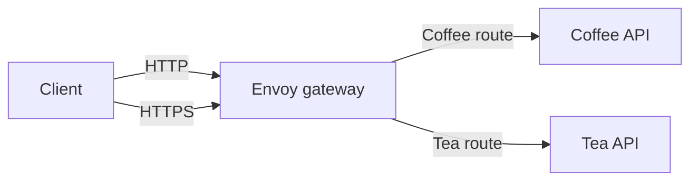
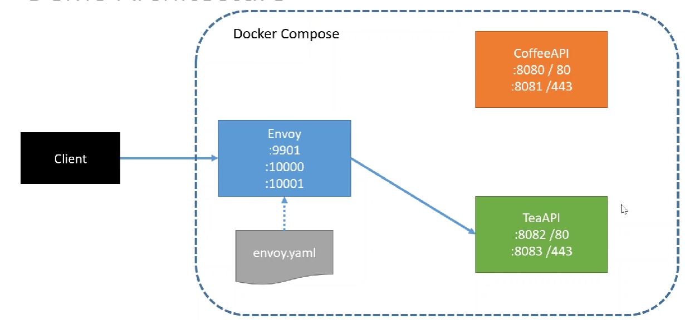
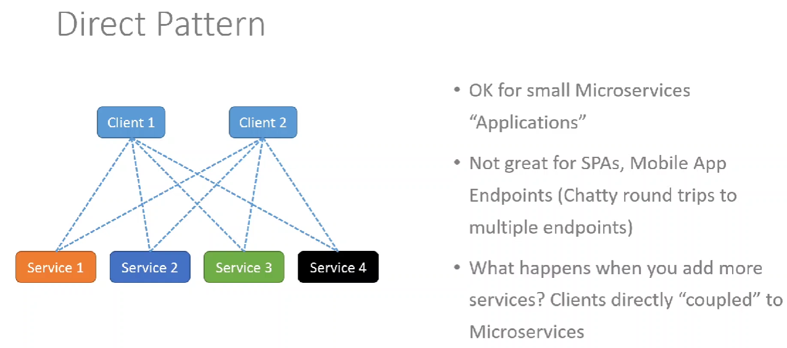
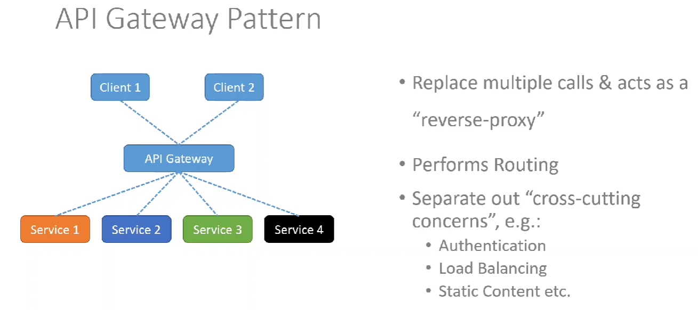
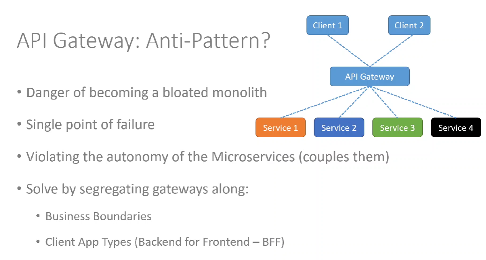
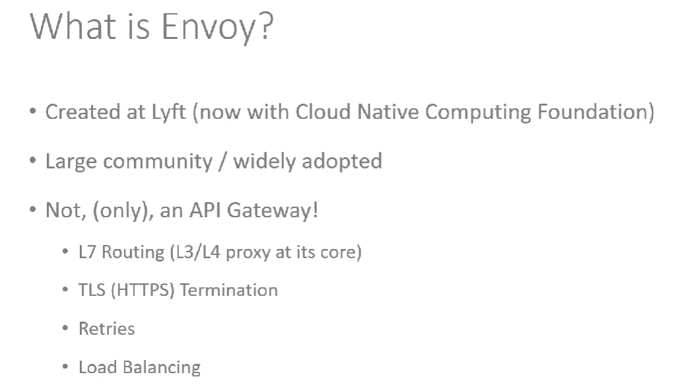
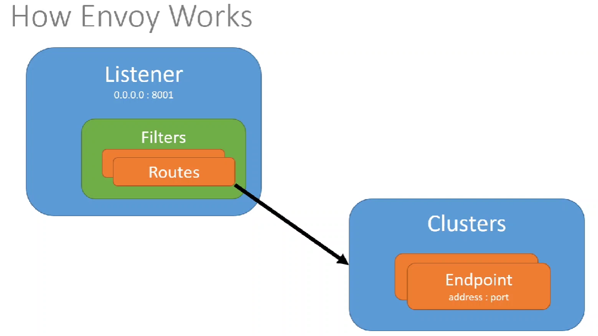
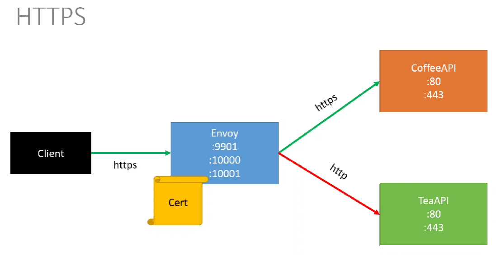

# Envoy API Gateway Demo

A small, containerized demonstration of using [Envoy](https://www.envoyproxy.io/) as an API gateway in front of two ASP.NET Core APIs. Envoy exposes a single entry point, routes requests to the Coffee or Tea service based on the URL path, and demonstrates HTTP and HTTPS listeners.

## What this project demonstrates

- Two independent ASP.NET Core Web APIs: Coffee and Tea.
- Docker Compose networking between the gateway and its backend services.
- Envoy path-based routing and prefix rewriting.
- TLS termination at Envoy, plus an HTTPS upstream connection to the Coffee API on the HTTPS listener.
- How a gateway provides a common entry point instead of requiring clients to address each service directly.

This is a learning/demo project, not a production-ready gateway configuration.

## Tech stack

| Technology                           | Use                                                                         |
| ------------------------------------ | --------------------------------------------------------------------------- |
| C# and ASP.NET Core Web API (.NET 6) | Implements the Coffee and Tea backend APIs.                                 |
| Envoy Proxy 1.14.1                   | Listens for client requests and routes them to the backend services.        |
| Docker                               | Builds and runs the gateway and APIs as containers.                         |
| Docker Compose                       | Starts the services together on a shared network and publishes their ports. |
| YAML                                 | Configures Envoy listeners, routes, clusters, and upstream TLS.             |
| OpenSSL / X.509                      | Generates the localhost certificate used by Envoy's HTTPS listener.         |
| Swashbuckle / Swagger                | Provides development API documentation for the ASP.NET Core APIs.           |

## API gateway: what, why, when, and how

### What is an API gateway?

An API gateway is a server-side entry point between clients and one or more backend APIs. A client sends a request to the gateway; the gateway applies configured routing rules and forwards the request to the appropriate service. The response returns through the gateway to the client.

### Why use one?

A gateway can give clients one address to call while backend services remain separate. It can centralize cross-cutting features such as routing, TLS handling, authentication, rate limiting, observability, and load balancing. Which of these features are present depends on the gateway configuration; this demo focuses on routing and TLS.

### When is one useful?

An API gateway is useful when an application has multiple services and you want a consistent client-facing entry point, or when shared request-handling policies should be managed centrally. For a small application with just one API, adding a gateway may add unnecessary operational complexity.

### How does this project use one?

Clients call Envoy on port `10000` (HTTP) or `10001` (HTTPS). Envoy matches the incoming URL prefix, rewrites it to the backend API's controller route, and forwards the request to the corresponding Docker Compose service:

| Gateway request  | Rewritten path             | Backend     |
| ---------------- | -------------------------- | ----------- |
| `/c` or `/c/...` | `/coffee` or `/coffee/...` | `coffeeapi` |
| `/t` or `/t/...` | `/tea` or `/tea/...`       | `teaapi`    |

The APIs expose controller routes at `/coffee` and `/tea`; each `GET` returns a randomly selected drink. On the HTTPS listener, Envoy uses an HTTPS upstream cluster for Coffee, while Tea is still forwarded to its HTTP port.

### What is Envoy?

[Envoy](https://www.envoyproxy.io/) is an open-source proxy designed for service-to-service and edge networking. It receives connections, evaluates configured listeners and routes, and forwards requests to configured upstream services (called clusters in Envoy configuration). In this demo, Envoy is the edge proxy: Docker Compose lets it find the `coffeeapi` and `teaapi` services by their service names.

## Architecture



Envoy listens on HTTP port `10000`, HTTPS port `10001`, and admin port `9901`. It routes `/c` to `/coffee` and `/t` to `/tea`. The HTTPS listener presents the certificate mounted into the Envoy container. Its Coffee upstream cluster also uses TLS and connects to port `443`; the Tea upstream cluster uses HTTP on port `80`, including when the client connected to Envoy over HTTPS.

## Request workflow

1. The client sends a request to Envoy on port `10000` (HTTP) or `10001` (HTTPS).
2. For HTTPS requests, Envoy completes the client-side TLS connection using the configured certificate.
3. Envoy checks the URL prefix: `/c` selects Coffee, and `/t` selects Tea.
4. Envoy rewrites the prefix to the backend controller route (`/coffee` or `/tea`) and forwards the request over the configured upstream connection.
5. The selected API returns a drink; Envoy relays the response to the client.

## Run locally

Prerequisites: Docker Desktop (or Docker Engine) with the Docker Compose command available.

From the repository root, build and start the services:

```powershell
docker compose up --build
```

Try the gateway routes:

```text
http://localhost:10000/c
http://localhost:10000/t
https://localhost:10001/c
https://localhost:10001/t
```

The HTTPS certificate is for local demonstration. If it is self-signed and not trusted by your machine, use a client option that skips certificate verification for local testing only (for example, `curl -k https://localhost:10001/c`). Do not use that option for normal secure connections.

To stop the containers, press `Ctrl+C` and run:

```powershell
docker compose down
```

## Ports

| Host port      | Container/service | Purpose                              |
| -------------- | ----------------- | ------------------------------------ |
| `9901`         | Envoy             | Envoy admin interface.               |
| `10000`        | Envoy             | HTTP gateway listener.               |
| `10001`        | Envoy             | HTTPS gateway listener.              |
| `8080`, `8081` | Coffee API        | Direct HTTP and HTTPS backend ports. |
| `8082`, `8083` | Tea API           | Direct HTTP and HTTPS backend ports. |

The backend ports are published for local development; normal gateway usage should use ports `10000` or `10001`.

## Reference images

The repository includes these diagrams and illustrations:

### Example architecture



### Direct calls compared with an API gateway







### Envoy and HTTPS







## Project layout

```text
.
├── docker-compose.yaml
├── Envoy/
│   ├── Dockerfile
│   └── envoy.yaml
├── CoffeeAPI/
│   ├── Controllers/CoffeeController.cs
│   └── Dockerfile
├── TeaAPI/
│   ├── Controllers/TeaController.cs
│   └── Dockerfile
└── img/
```

## Development notes

- The Envoy image is pinned to version `1.14.1`; its configuration uses Envoy v2 HTTP connection manager fields. This is an older demo configuration and may need updating for newer Envoy releases.
- `CoffeeAPI` redirects HTTP requests to HTTPS; `TeaAPI` does not enable HTTPS redirection.
- The certificate and private key are intended for local testing only. Replace them with appropriately managed certificates and keys before deploying anywhere beyond a local development environment.
- Envoy's admin interface and backend ports are published to the host by Compose. Restrict or remove those published ports in any non-local deployment.

## Reference: Les Jackson
